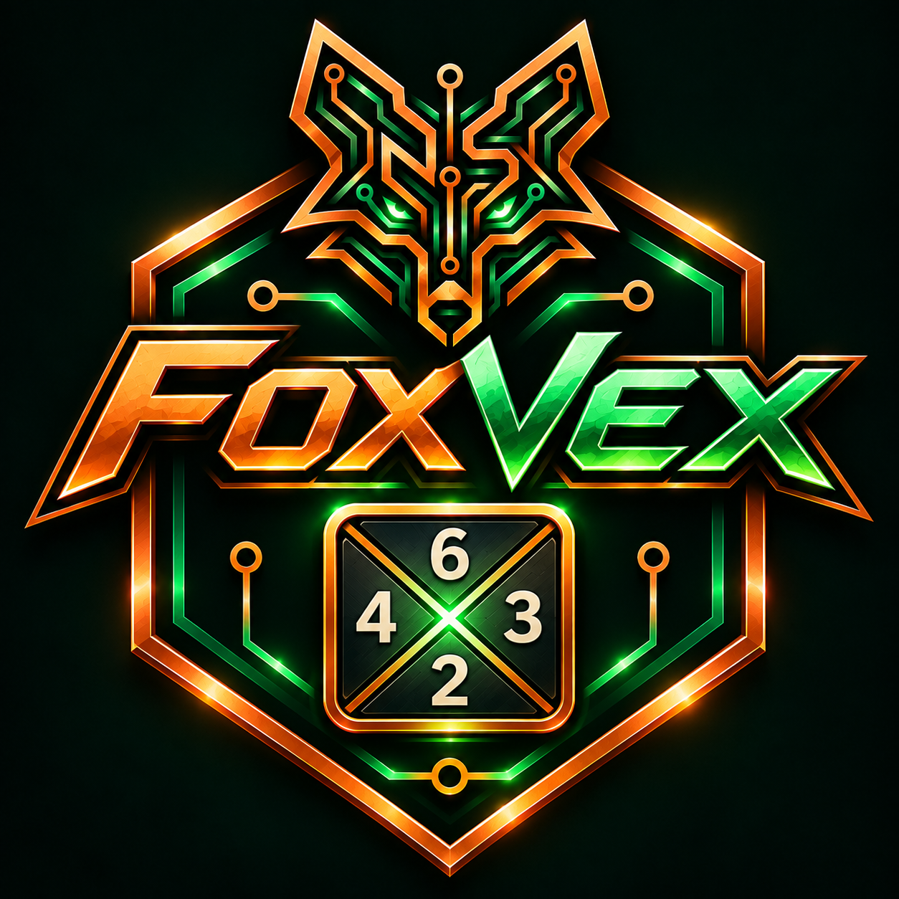
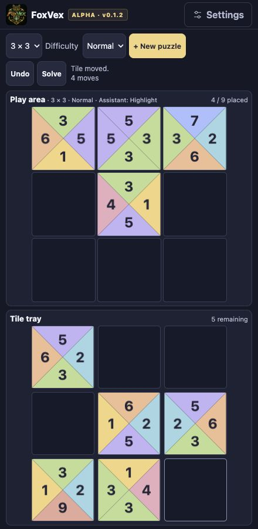
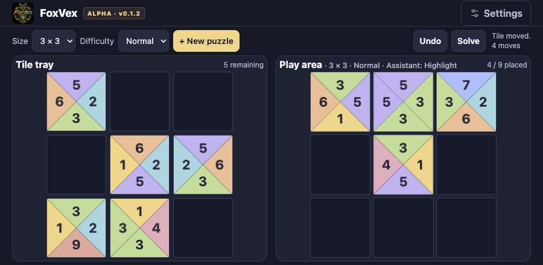
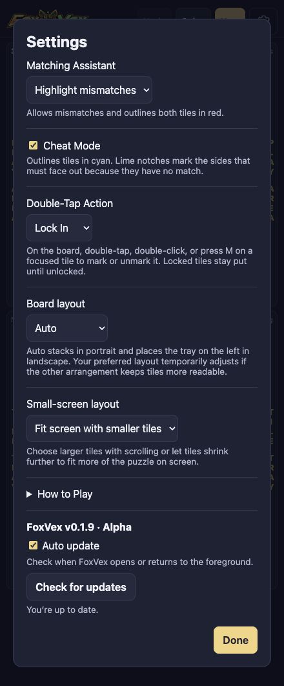
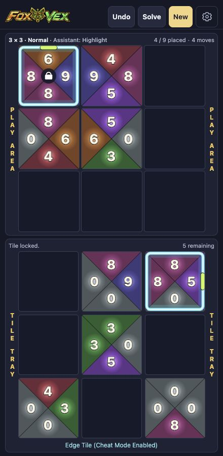
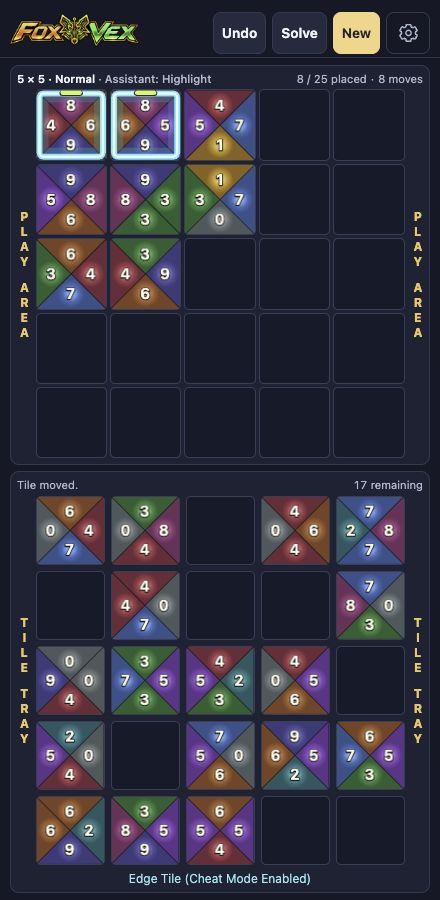

# FoxVex



**Version 0.1.3 · Alpha**

<p align="center">
  <a href="https://natsteff.github.io/foxvex/"></a>
</p>

**Play FoxVex in your browser.** [Open the game](https://natsteff.github.io/foxvex/)

Inspired by classic TetraVex-style puzzles, FoxVex brings traditional number-matching gameplay to a modern interface. Drag tiles from the tray onto the board and match touching numbers to solve puzzles from 2×2 to 5×5.

- **Three difficulty levels** vary how many edges give away a tile’s position.
- **Matching Assistant** can prevent mismatches, outline them in red, or leave them unmarked.
- **Optional Cheat Mode** marks tiles that have an unmatched edge and must go on the border.
- **Lock In and Pencil In** let you double-tap a placed tile to lock it in place or flag a tentative placement with a question mark.
- **Local saves** let you resume a puzzle in the same browser, including locked and penciled-in tiles. You can also undo moves or reveal the solution.
- **Puzzle completion** shows your move count and a **Next Puzzle** button. Solve in one move per tile to earn a perfect-game badge and confetti.

FoxVex supports mouse and keyboard on desktop and touch on phones and tablets. Landscape puts the tray on the left and the board on the right. Phone portrait stacks the board above the tray. On small screens, choose larger tiles with scrolling or smaller tiles that fit more of the puzzle on screen. Controller support and FOX Arcade validation are planned.

## Add FoxVex to your Home Screen

1. Open [FoxVex](https://natsteff.github.io/foxvex/) on your phone or tablet.
2. **iPhone or iPad** — In Safari, tap **Share**, choose **Add to Home Screen**, turn on **Open as Web App** if offered, then tap **Add**.
3. **Android** — In Chrome, open the **⋮** menu and choose **Install and create shortcut** or **Add to Home screen**. Choose **Install** if prompted.
4. Launch **FoxVex** from its fox logo. Internet access is required to load the game.

## Mobile screenshots

The same 3×3 Normal puzzle in progress with default settings. Portrait stacks the play area above the tray. Landscape puts the tray on the left.





The 3×3 puzzle with Cheat Mode enabled, Matching Assistant set to Highlight mismatches, and Double-Tap Action set to Lock In. Cyan notches mark unmatched edges in the tray and on the board. The padlock marks a tile the player has locked in place.

| Settings | 3×3 in progress |
| --- | --- |
|  |  |

**5×5 portrait** with default settings and eight tiles placed.



## Controls

| Action | Mouse or touch | Keyboard |
| --- | --- | --- |
| Move or swap a tile | Drag and drop | Tab between grids, use arrows to focus a slot, and press Enter or Space to pick up or drop |
| Cancel a move | Release outside the grids | Escape |
| Toggle **Lock In** or **Pencil In**, as selected in Settings | Double-tap or double-click a placed tile | Focus a placed tile and press M |
| Undo, check, or reveal the solution | Use the puzzle toolbar | Tab to a toolbar control and press Enter |

Tiles keep their orientation. A move into an occupied slot swaps the two tiles. **Matching Assistant** in Settings lets you prevent mismatches, highlight them in red (the default), or leave them unmarked. When Matching Assistant is **Off**, use **Check** to see whether any touching numbers differ.

Choose **Size** and **Difficulty**, then select **New puzzle** to apply them. The Play area heading shows the size and difficulty of the puzzle in progress. Easy has two forced corners and two more border clues. Normal has two border clues, and Hard has none. An edge with no match on the opposite side of any other tile must face out.

Turn on **Cheat Mode** in Settings to see cyan outlines on tiles with unmatched edges. Each notch marks a side with no opposite-side match on any other tile, so that side must face out. The marks follow the tile onto the board.

On phones, the board sits above the tray in portrait. In Settings, **Fit screen with smaller tiles** lets tiles shrink further when space is tight. If the page scrolls, hold a dragged tile near the top or bottom of the screen to scroll.

The current puzzle saves in your browser. Undo history lasts until you reload or start a new puzzle. Solve reveals a valid arrangement and can be undone. Complete a puzzle yourself to see your move count and **Next Puzzle** in the tray.

**Double-Tap Action** in Settings defaults to **Lock In**. A locked tile stays put until you unlock it. Choose **Pencil In** to mark tentative placements with a centered question mark or **Disabled** to turn off the gesture. Tile marks save with the current puzzle and can be undone during play.

The version appears during startup, in the Alpha badge, and in Settings. **Auto update** checks for a newer build when you open FoxVex or return to it. Use **Check for updates** in Settings to check manually.

## Run locally

Use Node.js 24 and pnpm 11.

```sh
pnpm install --frozen-lockfile
pnpm dev
```

Open the local URL printed by Vite. Run `pnpm build` followed by `pnpm preview` to try the production build.

Built with Phaser and TypeScript. Project owner **Nate S**.
